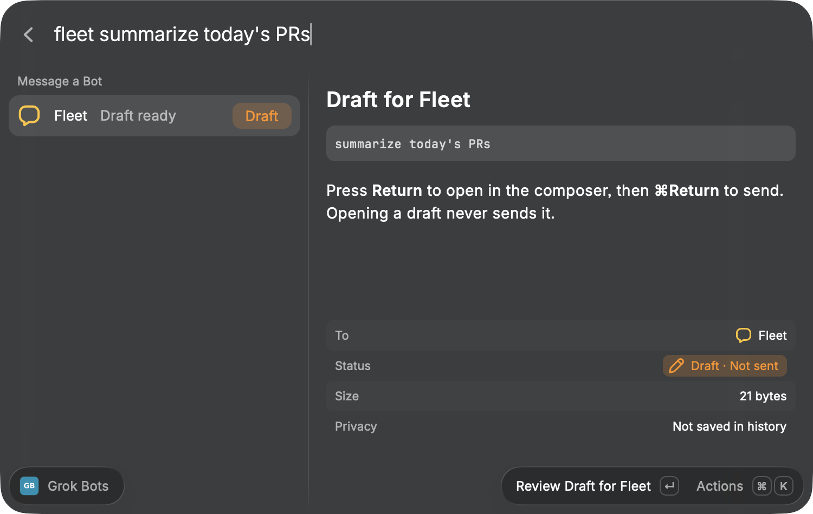
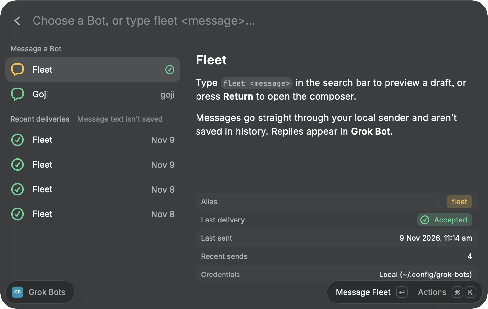
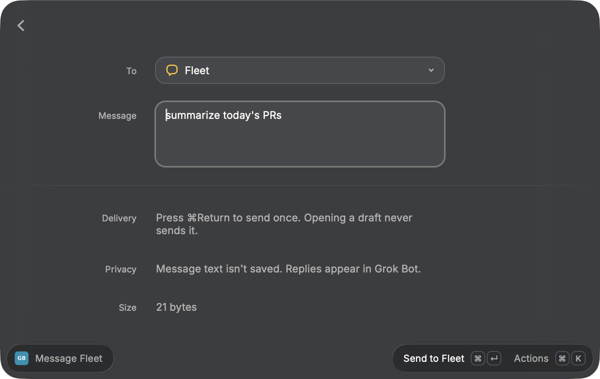

<p align="center">
  
</p>
<p align="center">
  <a href="https://github.com/saphid/grok-bots-raycast/actions/workflows/check.yml"></a>
  
  
  <a href="LICENSE"></a>
</p>

Message your existing **Grok Bots** without leaving your keyboard. Choose a Bot, write a message, and get a clear delivery receipt. Read its reply in the Grok Bot app.

- **Quick to compose.** Type `fleet say hi` → Return to review → ⌘Return to send.
- **Credentials stay local.** Hidden setup prompts; no keys in Raycast preferences, message arguments, or the repository.
- **Send once.** A saved request ID, explicit submit, and no automatic retries.
- **Useful history.** Delivery states and timestamps, without saving message text.

<p align="center">
  
  <br><sub>Live draft preview in native Raycast. Press Return to review, then ⌘Return to send (⌘⇧D toggles details).</sub>
</p>

| Bot list & delivery summary | Composer |
| --- | --- |
|  |  |

## Get started

You need **macOS**, [Raycast](https://www.raycast.com/), [Node.js 24.11+](https://nodejs.org/en/download), and a Grok Bot with a webhook routine. This integration uses your hosted Bot, not an xAI inference API key.

### 1. Install the extension and local sender

```sh
git clone https://github.com/saphid/grok-bots-raycast.git
cd grok-bots-raycast
npm ci
npm run setup
```

Setup installs `~/.local/bin/grok-bots` and checks it. If you already have that sender, it keeps it unchanged. Keep this checkout and Node.js in place: the sender uses their absolute paths.

### 2. Connect a Bot privately

[Create a webhook routine in your Bot](docs/setup.md#connect-your-bot), then run:

```sh
npm run bots -- add fleet
```

Enter its display name, webhook URL and **key only** at the prompts. The URL and key are hidden while you type. Credentials stay in `~/.config/grok-bots` with private file permissions. Repeat with a different alias for each Bot. Already configured? Skip this step.

### 3. Open it in Raycast

```sh
npm run dev
```

When it says **built extension successfully**, open Raycast and choose **Message Grok Bot**. Select a Bot, or type `fleet say hi`. **Return** opens the draft; **⌘Return** sends it.

After registration you can stop the watcher with **Ctrl+C**; the compiled command stays installed. Run `npm run dev` again after updating. This is a local extension, not a Raycast Store listing.

If an external `raycast://` link shows **Request to run Message Grok Bot**, choose **Always Run Command** once to remember approval for this command. Launching it directly inside Raycast avoids the external-link prompt.

[Full setup and troubleshooting →](docs/setup.md)

## Understand delivery

| State        | What it means                                       | Next step                                                               |
| ------------ | --------------------------------------------------- | ----------------------------------------------------------------------- |
| **Accepted** | The webhook accepted the message.                   | Open Grok Bot to read its reply.                                        |
| **Rejected** | The webhook returned a definitive client rejection. | Check the routine and credentials privately.                            |
| **Unknown**  | It may have arrived; delivery is uncertain.         | Inspect the Bot conversation before sending again. Keep the request ID. |

**Check Delivery Receipt** reads the same request ID and never resends. **Show Delivery Details** reveals the ID and HTTP status. The extension does not read Bot replies or claim that accepted work is complete.

## Develop

```sh
npm ci
npm run check
npm audit
```

Checks run on Linux and macOS and never contact a real Bot. The suite covers sender credentials and redirects, duplicate protection, failed deliveries, hidden terminal prompts, installation without overwriting an existing sender, history consistency, and composer input.

| Area                    | Location   |
| ----------------------- | ---------- |
| Native Raycast command  | `src/`     |
| Standalone local sender | `cli/`     |
| Setup command           | `scripts/` |
| Regression tests        | `test/`    |

See [Contributing](CONTRIBUTING.md), [Security](SECURITY.md), and the [sender contract](docs/sender.md). Licensed under [MIT](LICENSE). This is an independent integration; it is not an official Raycast, xAI, or Cursor product.
